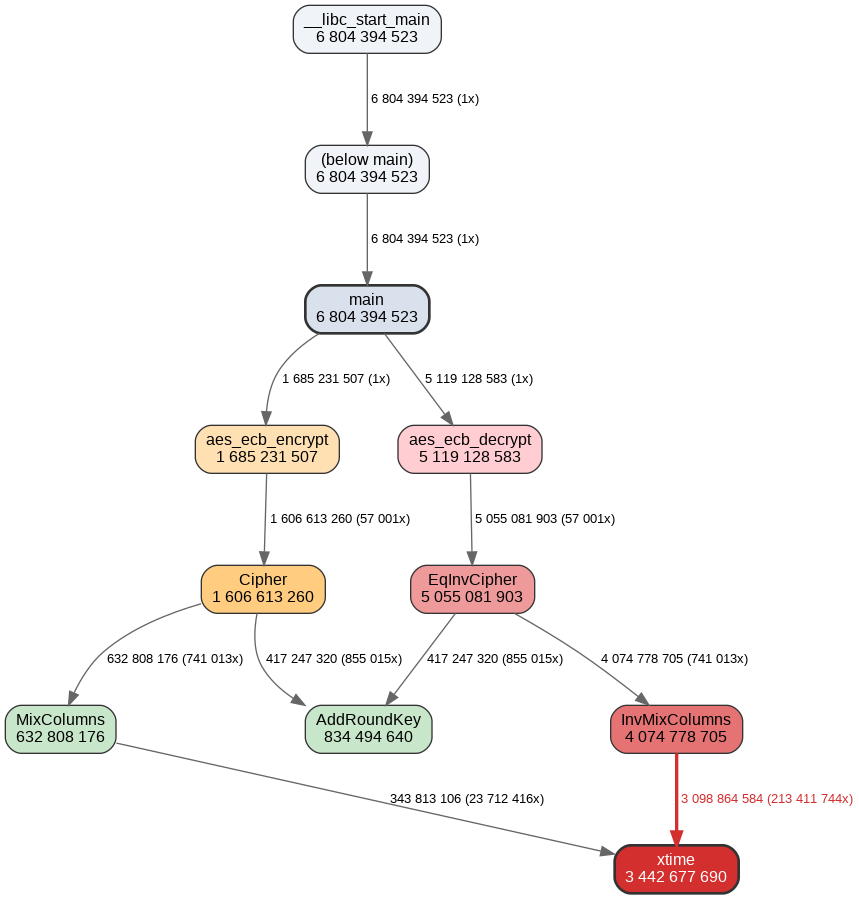
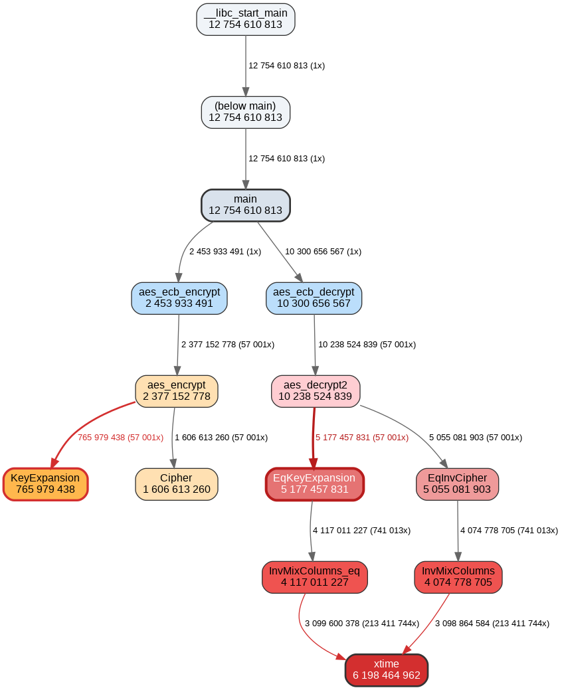
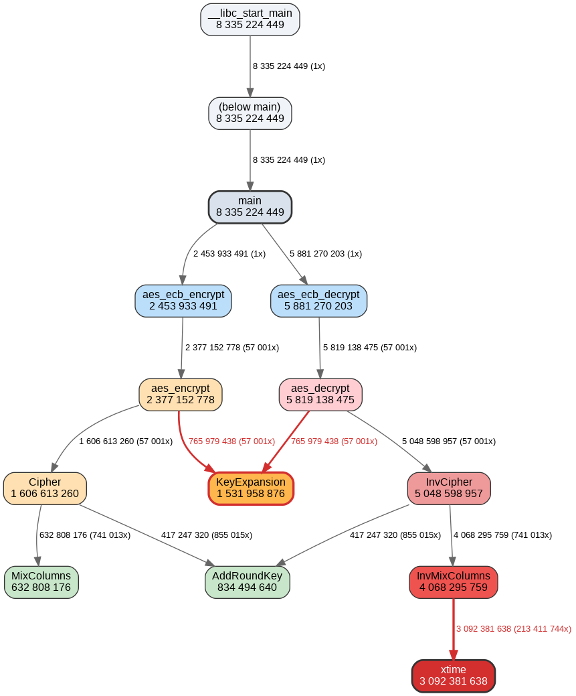
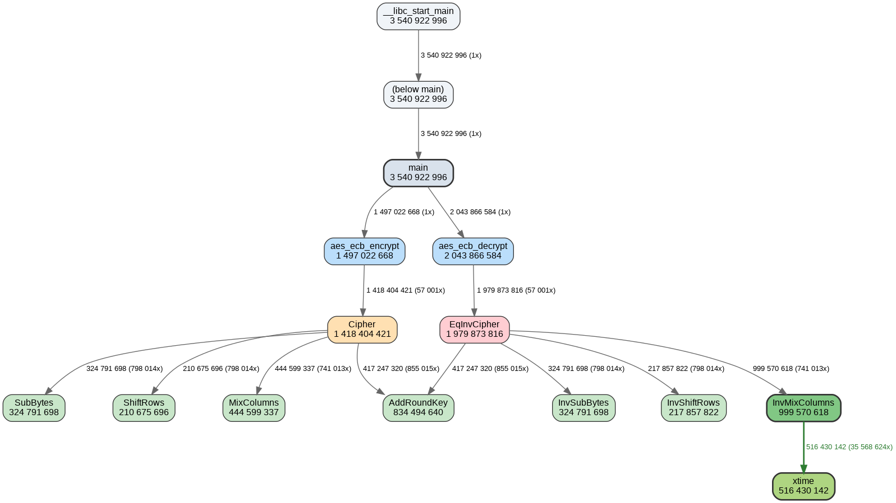

# Carnet de Bord : Projet Cryptographie

---

<b>Séance 1 - (13/03/26)</b>

### A. Tâches à réaliser avant la séance
*(Non spécifié pour le démarrage du projet)*

### B. Tâches effectivement réalisées
- [x] **Équipe** : Implémentation de la classe `Anneau`.
- [x] **Équipe** : Représentation des polynômes (liste de coefficients).
- [x] **Équipe** : Instanciation des polynômes dans la classe `Anneau`.
> **Note** : La multiplication de polynômes restait à finaliser à l'issue de cette séance.

---

<b>Séance 2 - (01/04/26)</b>

### A. Tâches à réaliser avant la séance
#### Siméon
- [x] Faire le pseudo-code de l'algorithme d'Euclide étendu.
- [x] Préparer des tests pour la division euclidienne et Euclide étendu.

#### Jamyson
- [x] Coder la multiplication de polynômes en Haskell.
- [X] Faire le pseudo-code de la division euclidienne des polynômes.

### B. Tâches effectivement réalisées en séance
#### Siméon
- [x] Implémentation de l'algorithme d'Euclide étendu (pour les polynômes de Z/2Z).
- [x] Implémentation de l'inversion de polynômes.
- [x] Implémentation de la structure de corps, le type GF28 et la multiplication de ses élements (avec un modulo m)

#### Jamyson
- [x] Implémentation de la division euclidienne de polynômes.
- [x] Implémentation d'un affichage personnalisé (`Show`) pour les polynômes.

> **Note** : La résolution de quelques conflits lors du `pull` nous a permis de mieux prendre en main la gestion des fusions avec Git.

---

<b>Séance 3 - (21/04/26)</b>

## Séance 3 —

### Travail en autonomie (Hors séance)
- [x] **Jamyson** : Remodelage de la structure du projet (séparation du code en 7 fichiers distincts : `Anneau.hs`, `Z2.hs`, `Polynome.hs`, `GF28.hs`, `Euclide.hs`, `AES.hs`, `Main.hs`).

### A. Tâches à réaliser avant la séance
#### Siméon & Jamyson

- Travail commun
  - [x] Comprendre les 4 fonctions clés de l’algorithme AES, identifier les types demandés, retour et parametres attendus  
  - [x] Implémenter au moins une de ces fonctions  

### B. Tâches effectivement réalisées
#### Jamyson
- [x] **Implémentation AES** : Codage des transformations *State* : `subBytes`, `shiftRows` et `mixColumns`.
- [x] **Déchiffrement AES** : Implémentation des transformations inverses de l’état (`invAddRoundKey`, `invSubBytes`, `invShiftRows`, `invMixColumns`) et ajout de leurs tests de validation.
- [x] **Validation** : Tests unitaires exécutés en s’appuyant sur des exemples issus de la documentation.
- [x] **Refonte de la gestion des polynômes** :
    - **Correction de bug** : Suppression d’une boucle infinie dans `mixColumns`. La division euclidienne a été adaptée pour fonctionner non seulement sur $Z_2$, mais aussi sur les octets ($GF(2^8)$).
    - **Calculs plus fiables** : Amélioration de `de_pol`.
    - **Comparaison correcte** : Définition d’une instance `Eq` personnalisée.

> **Note** : Une version alternative de subBytes utilisant SBox.hs a été codée mais n'est pas utilisée.

#### Siméon

- [x] **Implémentation AES** : La fonction `addRoundKey`.
- [x] **Génération des clés** : Implémentation de `keyExpansion` et de `cipherKey` pour gérer le planning de clés.
- [x] **Interface de données** : Mise en place des fonctions de conversion (bits vers *State*) et d’affectation pour le traitement des blocs.
- [x] **Validation** : Création et exécution des tests unitaires associés aux nouvelles fonctionnalités.
- [x] **Plan** : Détermination des objectifs du projets, de la démarche future à suivre, étude avancée de la documentation.
- [x] **Restructuration du projet** : GF28X, State et l'Instanciation ont été repensés.

---

<b>Séance 4 - (06/05/26)</b>
 

### A. Tâches à réaliser pendant la séance
#### Siméon & Jamyson

- **Travail commun : Orchestration du Déchiffrement**
  - [x] Analyser la structure de l'algorithme *Equivalent Inverse Cipher* dans le standard NIST (ordre des transformations et des clés).
  - [x] Réaliser les tests du chiffrement et du déchiffrement.
  - [x] Préparer les affichages visuels pour les 4 fonctions AES, les clés et les états.

### Travail en autonomie (Hors séance)

#### Siméon
- [x] **Refactorisation et nettoyage du code (`AES.hs`)** : Simplification de plusieurs fonctions (`subBytes`, `mixColumns`, `subWord`, `invSubBytes`, `invMixColumns`) en supprimant les variables intermédiaires superflues.
- [x] **Correction algébrique** : Ajustement de la multiplication polynomiale `mul_gf28x` (`take 4`) afin de garantir la bonne taille des polynômes retournés, ce qui corrige le comportement de `mixColumns`.
- [x] **Amélioration de l'affichage et du débogage** :
    - Refonte des instances `Show` dans `Z2.hs` et `Polynomes.hs` pour obtenir un affichage plus lisible (listes standards plutôt que `Z2 x`).
    - Ajout d’un module d’affichage hexadécimal dans `AES.hs` (`gf28ToHex`, `afficher_key`, `afficher_state`) pour faciliter la lecture des états et des clés.
- [x] **Initialisation des tests** : Création de la structure de base du script de validation globale `tests_chiffrement.ghci`.

#### Jamyson
- [x] **Complétion des tests et validation NIST** : Reprise et complétion du script `tests_chiffrement.ghci`.
    - Ajout de tests de validation automatisés pour valider le chiffrement complet (Forward Cipher), en s’appuyant sur les annexes B et C.1 du standard FIPS 197.
    - Ajout de tests d’involution pour vérifier la validité de chaque transformation inverse (déchiffrement).
- [x] **Débogage matriciel** : Identification et correction d’un problème de transposition dans `state_vers_octets`. La matrice est maintenant reconstruite correctement en lecture colonne par colonne (au lieu de ligne par ligne), ce qui a permis de valider définitivement les tests AES.

### B. Tâches effectivement réalisées

#### Siméon
- [x] **Déchiffrement (Inverse Cipher)** :
    - Implémentation complète de `invCipher` ainsi que de la boucle de déchiffrement associée dans `AES.hs`, ce qui complète désormais toute la chaîne de déchiffrement AES.

- [x] **Validation de la généralisation (clés 192/256 bits)** :
    - Tests du chiffrement et du déchiffrement pour les différentes tailles de clés (`Nk` = 4, 6, 8) et nombres de rounds (`Nr` = 10, 12, 14).
    - Vérification du bon comportement de l’algorithme lors du changement de paramètres de clé.

- [x] **Tests et validation NIST** :
    - Exécution avec succès des tests des annexes du standard AES (Key Expansion et Cipher complet).
    - Validation des tests (`invCipher` après `cipher`) sur l’ensemble des cas testés.

#### Jamyson
- [x] **Généralisation des fonctions sur les polynômes (division et algorithme d'Euclide)** :
    - **Généralisation de la structure algébrique** : Mise à jour de la classe `Anneau` pour y ajouter l'opération de soustraction (`sub`), et implémentation de celle-ci pour `Z2`, `GF28`, `GF28X` et les polynômes.
    - **Adaptation des algorithmes à un corps quelconque** : Modification des fonctions `de_pol`, `euclide` et `inv_p` pour imposer la contrainte `Corps` au lieu de `Anneau`, et utilisation de la vraie soustraction (`sub`) dans le calcul des coefficients de Bézout.
    - **Normalisation et corrections** : Ajout d’une normalisation du PGCD dans `inv_p` afin d’obtenir un polynôme unitaire (coefficient dominant égal à 1) et résolution des problèmes d'inversion liés aux zéros non supprimés en fin de polynômes.
    - **Tests et validation globale** : Création du corps abstrait `Z3` et validation de la généralisation sur plusieurs cas avancés (changement de corps $GF(2)$/$GF(3)$, dividende < diviseur) via `tests_corps_quelconque.ghci`. Vérification du bon fonctionnement de l’AES après les modifications grâce à l’exécution complète de `tests_anneaux.ghci` et `tests_chiffrement.ghci`.

### Finalisation de l'implémentation en Haskell (Après la Séance 4)

#### Jamyson
- [x] **Documentation globale** : Rédaction de la documentation complète détaillant l'architecture du projet (`documentation_projet.md`).
- [x] **Stratégie de validation** : 
    - Création d'un script de test spécifique aux fonctions de l'AES (`tests_fonctions_AES.ghci`).
    - Création d'un script de validation globale (`tests_complets.ghci`).
    - Amélioration et réorganisation générale des scripts de tests existants.

---

 

<b>Semaine de PX222 : Implémentation AES en C - (08/06/26-12/06/26)</b>

## Analyse de l'entropie des modes de chiffrement

Afin de comparer les modes ECB et CBC, nous avons calculé l'entropie de l'image de Tux non chiffrée, puis chiffrée en ECB et en CBC à l'aide du programme `entropie.c`.

Les résultats obtenus sont les suivants :

| Fichier | Entropie |
|----------|----------|
| Image originale (`Tux.bmp`) | 3,938782 |
| Image chiffrée en ECB (`Tux_chiffre_256_ecb.bmp`) | 6,994900 |
| Image chiffrée en CBC (`Tux_chiffre_cbc_128.bmp`) | 7,999785 |

On observe tout d'abord que l'image originale possède une entropie relativement faible. Cela est normal, puisqu'une image contient de nombreuses zones uniformes et donc beaucoup de redondance.

Après chiffrement, l'entropie augmente fortement dans les deux cas, signe que les données deviennent beaucoup plus difficiles à prédire. Toutefois, une différence importante apparaît entre les modes ECB et CBC.

### Comparaison des modes ECB et CBC

Le mode **ECB (Electronic Codebook)** chiffre chaque bloc indépendamment des autres. Ainsi, deux blocs identiques dans l'image d'origine produisent systématiquement deux blocs chiffrés identiques.

Dans le cas de l'image Tux, les grandes zones de couleur uniforme génèrent de nombreux blocs identiques. Même après chiffrement, certaines structures visuelles restent donc perceptibles. Cela explique pourquoi l'entropie obtenue en ECB reste limitée à environ 7,0.

Le mode **CBC (Cipher Block Chaining)** fonctionne différemment. Avant d'être chiffré, chaque bloc est combiné avec le bloc chiffré précédent à l'aide d'un XOR. Le premier bloc utilise quant à lui un vecteur d'initialisation (IV).

Grâce à ce mécanisme, deux blocs identiques dans l'image d'origine produisent des blocs chiffrés différents. Les motifs visuels disparaissent alors complètement et le résultat se rapproche d'un bruit aléatoire.

### Entropie attendue pour un fichier correctement chiffré

Un algorithme de chiffrement moderne doit produire un résultat indiscernable d'une suite de données aléatoires.

Comme un fichier est constitué d'octets pouvant prendre 256 valeurs différentes (de 0 à 255), l'entropie maximale théorique vaut :

$$
H_{max} = \log_2(256) = 8
$$

Une entropie proche de 8 indique donc que toutes les valeurs d'octets apparaissent avec une probabilité presque identique, ce qui correspond au comportement attendu d'un chiffrement efficace.

### Conclusion

Les résultats obtenus sont cohérents avec la théorie.

- Le mode ECB améliore l'entropie de l'image, mais conserve encore une partie de sa structure interne. Son entropie reste limitée à environ 7,0.
- Le mode CBC atteint une entropie de 7,999785, extrêmement proche de la valeur maximale théorique de 8.

Cette différence confirme que le mode CBC masque beaucoup mieux les motifs présents dans les données d'origine et produit un résultat beaucoup plus proche d'un bruit aléatoire. Il constitue donc un choix bien plus sûr pour le chiffrement de données réelles.

## Analyse des performances de l'implémentation AES

Afin d'évaluer les performances de notre implémentation AES, nous avons réalisé plusieurs mesures sur le chiffrement et le déchiffrement de l'image de Tux. Une analyse des temps passés dans les différentes fonctions du programme a ensuite été réalisée à l'aide de *Valgrind* et *KCachegrind*.

### Version avec KeyExpansion calculée une seule fois – EqInvCipher

Dans un premier temps, les clés de ronde sont calculées une seule fois puis réutilisées pour l'ensemble des blocs. Le déchiffrement utilise ici la version équivalente `EqInvCipher`.

Les mesures obtenues sont les suivantes :

| Opération | Temps d'exécution | Débit |
|------------|------------------|---------|
| Chiffrement | 0,143 s | 6 367 982 o/s |
| Déchiffrement | 0,745 s | 1 224 169 o/s |

Le profil d'exécution correspondant est présenté ci-dessous :

<figure align="center">
  
  <figcaption><em>Figure 1 : Profil de performance de la fonction EqInvCipher avec KeyExpansion calculée une seule fois</em></figcaption>
</figure>

On remarque que le déchiffrement reste nettement plus lent que le chiffrement, malgré l'utilisation de la version équivalente `EqInvCipher` (l'opération InvMixColumns nécessite plus de 213 millions d'appels à xtime).

### Version avec KeyExpansion calculée une seule fois – InvCipher

Une seconde série de mesures a été effectuée en utilisant cette fois la version classique `InvCipher` pour le déchiffrement. Les résultats obtenus sont les suivants :

| Opération | Temps d'exécution | Débit |
|------------|------------------|---------|
| Chiffrement | 0,144 s | 6 332 605 o/s |
| Déchiffrement | 0,735 s | 1 240 321 o/s |

Le profil d'exécution associé est présenté ci-dessous :

<figure align="center">
  
  <figcaption><em>Figure 2 : Profil de performance de la fonction InvCipher avec KeyExpansion calculée une seule fois</em></figcaption>
</figure>

De manière assez surprenante, cette version se révèle légèrement plus rapide que celle utilisant `EqInvCipher`. Le grand nombre d'appels à la fonction `xtime()` semble en effet avoir un impact bien plus important sur les performances que le choix entre les deux variantes de déchiffrement. Dans notre implémentation logicielle en C, `EqInvCipher` n'apporte donc pas de gain mesurable. Son intérêt apparaît surtout dans le cadre d'implémentations matérielles, où il permet de réutiliser les mêmes blocs de calcul pour le chiffrement et le déchiffrement.

### Version avec recalcul de KeyExpansion à chaque bloc – EqInvCipher

Afin de mesurer l'impact de l'expansion de clé, nous avons ensuite modifié l'implémentation de façon à recalculer `KeyExpansion` pour chaque bloc traité.

Les résultats obtenus lors du chiffrement de l'image de Tux avec `EqInvCipher` sont les suivants :

| Opération | Temps d'exécution | Débit |
|------------|------------------|---------|
| Chiffrement | 0,209 s | 4 366 737 o/s |
| Déchiffrement | 1,440 s | 633 278 o/s |

Le profil correspondant est présenté ci-dessous :

<figure align="center">
  
  <figcaption><em>Figure 3 : Profil de performance de la fonction EqInvCipher avec KeyExpansion répétée.</em></figcaption>
</figure>

L'impact est immédiat : le débit chute fortement, en particulier lors du déchiffrement où il est pratiquement divisé par deux. Cette expérience confirme qu'il est préférable de calculer les clés de ronde une seule fois puis de les conserver en mémoire. L'analyse du graphe montre que cette perte de performances provient en grande partie de `EqKeyExpansion`, qui applique `InvMixColumns` lors de la préparation des clés. Cela génère un grand nombre d'appels supplémentaires à `xtime()`, déjà responsable d'une part importante du temps d'exécution.

### Version avec recalcul de KeyExpansion à chaque bloc – InvCipher

Les mêmes mesures ont été réalisées avec la version classique `InvCipher` (utilisation d'un tableau *decryption word*). Les résultats obtenus sont les suivants :

| Opération | Temps d'exécution | Débit |
|------------|------------------|---------|
| Chiffrement | 0,209 s | 4 354 955 o/s |
| Déchiffrement | 0,797 s | 1 144 319 o/s |

Le profil d'exécution est présenté ci-dessous :

<figure align="center">
  
  <figcaption><em>Figure 4 : Profil de performance de la fonction InvCipher avec KeyExpansion répétée.</em></figcaption>
</figure>

L'analyse du profil met en évidence un nombre extrêmement élevé d'appels à la fonction `xtime()`, utilisée pour effectuer les multiplications dans le corps fini `GF(2^8)`.

En examinant le code plus en détail, nous avons constaté que certaines valeurs étaient recalculées plusieurs fois au sein des fonctions `MixColumns`, `InvMixColumns` et `InvMixColumns_eq`. Plusieurs appels à `xtime()` étaient donc redondants et pouvaient être supprimés.

### Optimisation des fonctions MixColumns et InvMixColumns

Après réécriture de ces fonctions afin d'éviter les calculs répétés, les performances ont été réévaluées.

Pour la version utilisant `InvCipher`, nous obtenons :

| Opération | Temps d'exécution | Débit |
|------------|------------------|---------|
| Chiffrement | 0,132 s | 6 908 603 o/s |
| Déchiffrement | 0,209 s | 4 368 806 o/s |

Pour la version utilisant `EqInvCipher`, nous obtenons :

| Opération | Temps d'exécution | Débit |
|------------|------------------|---------|
| Chiffrement | 0,132 s | 6 890 187 o/s |
| Déchiffrement | 0,211 s | 4 327 926 o/s |

<figure align="center">
  
  <figcaption><em>Figure 5 : Profil d'exécution après optimisation.</em></figcaption>
</figure>

Après optimisation, le nombre d'appels à `xtime()` dans `InvMixColumns` est passé de plus de 213 millions à environ 35,5 millions. Cette réduction allège considérablement la charge de calcul et se traduit par une nette amélioration des performances. Le gain est particulièrement visible lors du déchiffrement, dont le débit est multiplié par plus de trois dans certains cas.

Les performances obtenues avec `EqInvCipher` et `InvCipher` deviennent désormais quasiment identiques. Cela montre que les écarts observés précédemment ne provenaient pas réellement des deux méthodes de déchiffrement elles-mêmes, mais plutôt du grand nombre d'appels redondants à `xtime()`, qui étaient très coûteuses pour l'algorithme.

Cette analyse montre qu'il est souvent plus efficace d'examiner en détail le comportement du programme avant de chercher à modifier l'algorithme lui-même. Dans notre cas, une simple optimisation locale a finalement apporté des gains bien plus importants que le choix entre les variantes `EqInvCipher` et `InvCipher`.

