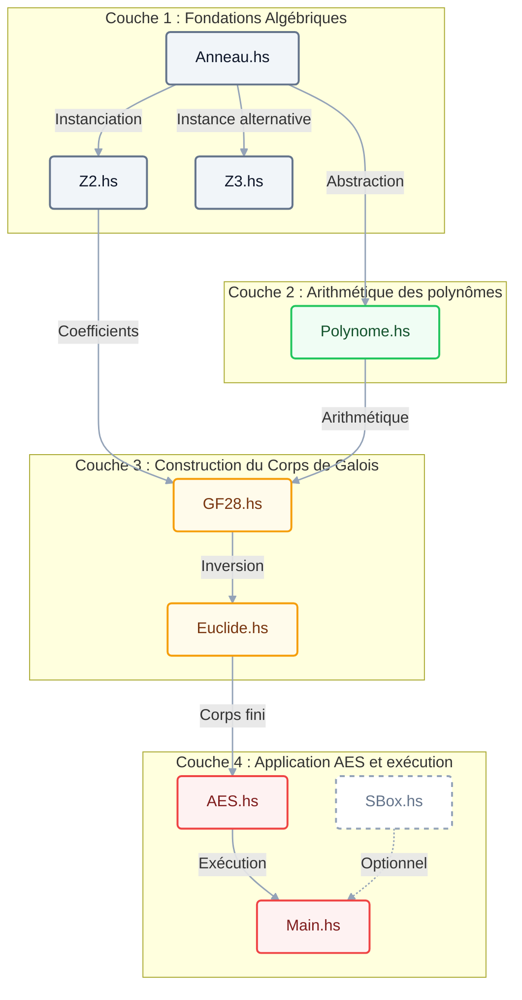

# PX222 MATHS-INFO — Implémentation cryptographique : de l’algèbre abstraite à l’AES

## Introduction

Ce projet propose une implémentation complète du standard de chiffrement AES (*Advanced Encryption Standard*) développée en Haskell. Au-delà de la simple reproduction de l’algorithme décrit dans la norme FIPS 197, l’objectif a surtout été de construire une architecture reposant sur une séparation claire entre les outils algébriques génériques et la logique propre au chiffrement.
Cette approche s’appuie sur les capacités du système de types de Haskell pour modéliser progressivement des concepts fondamentaux tels que les anneaux, les corps et les polynômes, avant de les spécialiser pour les besoins de l’AES. L’organisation du code en couches d’abstraction a été pensée pour prévenir toute dépendance circulaire et garantir l’indépendance des briques mathématiques vis-à-vis des contraintes propres à la spécification de l’algorithme, ce qui facilite à la fois la maintenance du code et la validation progressive de chaque étape.

Ce document présente l’organisation générale du projet à travers trois axes principaux : le rôle des différents modules dans l’architecture globale et leur contenu, l’étude des dépendances entre les fichiers et de la manière dont les différentes couches du projet s’articulent entre elles, ainsi que la stratégie de validation utilisée pour tester l’implémentation et vérifier sa conformité aux vecteurs officiels du NIST (*National Institute of Standards and Technology*).

De ce fait, il sert avant tout de guide pour comprendre la manière dont le projet a été construit, comment le code a été découpé et comment les différents modules interagissent entre eux.

---

## 1. Organisation des modules et rôle des composants

Le code source est réparti sur quatre couches distinctes, chacune avec ses propres responsabilités. Cette section présente par conséquent le rôle de chacun des différents fichiers qui composent le projet. Les tableaux suivants détaillent en particulier le contenu de chacun ainsi que son utilité dans l'architecture générale.

<b>Fondations algébriques</b>

| Fichier | Rôle | Description |
| :--- | :--- | :--- |
| **`Anneau.hs`** | Interfaces algébriques de base | Définit les classes de types fondamentales `Anneau` (éléments neutres `zero`, `un`, et opérations `add`, `sub`, `mul`) et `Corps` (héritant d'`Anneau` avec l'opération `inv`) |
| **`Z2.hs`** | Arithmétique modulo 2 | Fournit le type `Z2` et définit ses instances `Anneau`, `Corps` et `Show`. Le module contient également une instance `Anneau` pour le type natif `Integer`. `Z2` sert de base aux coefficients des polynômes utilisés dans `GF28`. |
| **`Z3.hs`** | Tests de généricité | Fournit le type `Z3` ainsi que ses instances `Anneau`, `Corps` et `Show` pour l’arithmétique modulo $3$. Ce module est utilisé afin de vérifier que les algorithmes polynomiaux sont bien génériques et ne dépendent pas uniquement du cas binaire. |

<b>Arithmétique des polynômes</b>

| Fichier | Rôle | Description |
| :--- | :--- | :--- |
| **`Polynome.hs`** | Calcul polynomial générique | Définit la structure `Polynome a` ainsi que les opérations principales sur les polynômes : addition, soustraction, multiplication, division euclidienne (`de_pol`) et calcul du degré. Le fichier implémente également l’instance `Anneau` pour le type `Polynome a` (permettant de traiter les polynômes comme des anneaux) et redéfinit l'instance `Eq` pour assurer l'égalité stricte en nettoyant les zéros en fin de polynôme. |

<b>Construction du corps de Galois</b>

| Fichier | Rôle | Description |
| :--- | :--- | :--- |
| **`GF28.hs`** | Définition de la structure du corps fini | Déclare l’alias de type `GF2X` (`Polynome Z2`) ainsi que le type `GF28`, qui modélise le corps de Galois $GF(2^8)$ utilisé par l'AES. Ce module fixe également le polynôme irréductible `m` servant au calcul modulo et implémente l’instance `Anneau` (addition et multiplication modulo $m$). Il définit donc la structure du corps, tandis que son instance finale (`Corps GF28`) est fournie dans `Euclide.hs`. |
| **`Euclide.hs`** | Algorithmes de résolution | Introduit l'algorithme d'Euclide étendu (`euclide`) et le calcul d’inverse modulo $m$ (`inv_p`) pour tout type respectant la contrainte `Corps`. Ce fichier sert aussi à définir l’instance `Corps GF28` en s’appuyant sur la fonction d’inversion développée précédemment. |

<b>Implémentation de chiffrement/déchiffrement et exécution</b>

| Fichier | Rôle | Description |
| :--- | :--- | :--- |
| **`SBox.hs`** | Données du chiffrement | Contient la table de substitution (S-Box) de l’AES. Ce fichier sert surtout d’implémentation alternative basée sur une table de correspondance, tandis que le moteur principal privilégie un calcul algébrique. |
| **`AES.hs`** | Implémentation du chiffrement et du déchiffrement | Regroupe l’ensemble des fonctions liées à l’AES : représentation de l’état (`State`), expansion de clé (`keyExpansion`), transformations de chiffrement (`subBytes`, `shiftRows`, `mixColumns`, `addRoundKey`) ainsi que leurs versions inverses utilisées respectivement dans l'algorithme complet de chiffrement (`cipher`) et de déchiffrement (`invCipher`). Le module prend également en charge les variantes AES-128, AES-192 et AES-256. |
| **`Main.hs`** | Lancement du programme | Sert de point d’entrée pour exécuter le projet. Ce fichier importe les différents modules nécessaires afin d’utiliser les fonctions AES dans la monade `IO`. |

<b>Suivi du projet</b>

| Fichier | Rôle | Description |
| :--- | :--- | :--- |
| **`CDB.md`** | Carnet de bord | Regroupe le suivi du projet au fil des séances : objectifs, répartition des tâches, évolution de l’implémentation,... |

---

## 2. Architecture globale et dépendances entre modules

Cette partie décrit la structure générale du projet et la manière dont les différents modules s’articulent entre eux.
Les dépendances suivent une progression logique : les bases algébriques ont été définies en premier, puis utilisées pour construire des algorithmes polynomiaux génériques. Cet ensemble a ensuite permis de forger le corps de Galois spécifique (en couplant la structure de `GF28` et les algorithmes de `Euclide`) requis pour l’implémentation des fonctions de chiffrement et de déchiffrement de l’AES. 

> *Légende : Le sens des flèches ($A \rightarrow B$) indique que le module B dépend du module A pour fonctionner.*

### Organisation des dépendances
**Couche 1** : `Z2.hs` et `Z3.hs` sont les briques de base du projet. Ils ne dépendent que de `Anneau.hs` et servent uniquement à définir les structures utilisées ensuite dans les calculs polynomiaux et cryptographiques.

**Couche 2** : grâce au polymorphisme (`Polynome a`), `Polynome.hs` reste indépendant des types concrets comme `Z2` ou `Z3`. Il repose uniquement sur les interfaces définies dans `Anneau.hs`, ce qui permet de réutiliser les mêmes opérations quel que soit le corps utilisé, sans dépendre de l’AES.

**Couche 3** : `GF28.hs` définit la structure du corps et le polynôme irréductible utilisé par l’AES. `Euclide.hs` vient compléter cette base en ajoutant l’inversion modulo $m$ grâce à l’algorithme d’Euclide étendu, et finaliser ainsi la définition du corps de manière progressive sans créer de dépendances circulaires.

**Couche 4** : `AES.hs` utilise directement le corps de Galois sans avoir à redéfinir d'opérations arithmétiques. De son côté, `SBox.hs` contient seulement des données statiques (tables de substitution) et reste donc complètement indépendant du reste du projet, ce qui permet de séparer clairement les constantes de l’AES de la logique de calcul. `Main.hs` sert simplement de point d’entrée et relie les différents modules pour exécuter le programme.

---

## 3. Tests et validation

Cette section décrit la démarche mise en place pour garantir la fiabilité de l’implémentation. Plutôt que de se limiter à vérifier uniquement le résultat final du chiffrement, le projet adopte une approche progressive, en validant chaque étape du calcul au fur et à mesure.

Par conséquent, chaque couche algébrique ainsi que chaque transformation cryptographique est d’abord testée de manière unitaire, avant d’être intégrée dans des tests de bout en bout. Cette organisation permet de s’assurer du bon fonctionnement de chaque brique indépendamment, puis de la cohérence de l’ensemble du système.

### 3.1 Organisation des tests

La suite de tests est organisée en plusieurs scripts spécialisés, alignés avec l’architecture du projet :

**`tests_anneaux.ghci`** : Ce script couvre la couche mathématique de base. Il vérifie la cohérence des opérations arithmétiques sur les listes et sur les éléments de $\mathbb{Z}_2$. Il teste notamment l’addition, la multiplication, le calcul du degré ainsi que la division euclidienne sur les polynômes. Il permet également de valider le bon fonctionnement des algorithmes de résolution (Euclide étendu) et des multiplications associées à l’extension $GF(2^8)$.

**`tests_corps_quelconque.ghci`** : Ce script met en évidence la généricité de l’architecture. Il teste des structures polynomiales sur $\mathbb{Z}_3$ (modulo $3$) ainsi que sur $\mathbb{Z}_2$, afin de vérifier que les mêmes algorithmes s’appliquent correctement à différents corps finis. Il confirme le bon fonctionnement de la division euclidienne et de l’algorithme d’Euclide étendu en vérifiant systématiquement l’identité de Bézout ($A \times U + B \times V = PGCD$).

**`tests_fonctions_AES.ghci`** : Ce script isole et vérifie les principales fonctions utilisées dans l’algorithme AES. Il contrôle notamment les conversions hexadécimales, les manipulations matricielles ainsi que l’expansion de clé (`rotWord`, `subWord`), en vérifiant le nombre de mots générés pour AES-128 (44), AES-192 (52) et AES-256 (60). Il teste également de manière unitaire les transformations d’état (`subBytes`, `shiftRows`, `mixColumns`) ainsi que leurs opérations inverses respectives.

**`tests_chiffrement.ghci`** : Ce script couvre les tests d’intégration et vérifie le déroulement complet du chiffrement. Il exécute le chiffrement/déchiffrement complet (`cipher` et `invCipher`) sur un message, et réalise des passes de type *Round-Trip*, en chiffrant complètement un message puis en le déchiffrant afin de retrouver exactement le message initial. Il permet ainsi de valider la cohérence globale du système et sa conformité aux vecteurs de référence de la norme FIPS 197.

### 3.2 Vérification des vecteurs du NIST (FIPS 197)

Afin de garantir que l’implémentation ne soit pas seulement cohérente sur le plan logique mais également conforme à la norme, le projet a été confronté aux vecteurs de test fournis par le NIST.

**Annexe A (Key Expansion)** : le système vérifie la génération de l’expansion de clé pour les trois tailles définies par la norme (128, 192 et 256 bits). Les sous-clés obtenues correspondent exactement aux valeurs de référence du document FIPS 197.

**Annexe B (Cipher - états intermédiaires)** : le test ne se limite pas au résultat final du chiffrement. Il vérifie également le premier tour de l’AES-128 en comparant l’état de la matrice après chaque étape (`subBytes`, `shiftRows`, `mixColumns`) avec les valeurs de référence. Cela permet de valider le bon déroulement interne des transformations.

**Annexe C (chiffrement et déchiffrement)** : des tests complets sont effectués sur les trois variantes de l’AES (128, 192 et 256 bits). Le message est d’abord chiffré, puis déchiffré à l’aide des transformations inverses (`invShiftRows`, `invSubBytes`,...), ce qui permet de vérifier que l’on retrouve exactement le message initial.

### 3.3 Vérification globale du système

Afin de simplifier la validation de l’ensemble du projet, un script, `tests_complets.ghci`, a été mis en place. Il joue le rôle de test global en enchaînant l’exécution des différents scripts de tests afin de vérifier le comportement du système dans son ensemble.
Il sert ainsi de point d’entrée unique pour contrôler l’intégrité du projet. Toute modification des couches algébriques (`Z2`, `Polynome`) peut être immédiatement confrontée aux tests de niveau supérieur liés à l’AES, ce qui permet de détecter facilement d’éventuels problèmes introduits lors de l’évolution du code.

---

## Conclusion

L'aboutissement de ce projet démontre qu’il est possible de concilier la rigueur des mathématiques abstraites avec les exigences de performance et de conformité de la cryptographie moderne. En faisant le choix de Haskell et de son système de types avancé, cette implémentation s'affranchit d'une simple traduction de pseudo-code pour proposer une véritable modélisation algébrique de l'algorithme.

L’architecture du projet s’inspire directement de cette logique : les différentes couches (arithmétique des corps finis, polynômes, puis opérations AES) sont isolées de manière à refléter les niveaux d’abstraction du problème. Cette séparation permet de garder une architecture claire, et surtout de limiter les dépendances entre les briques mathématiques et la logique propre à l’algorithme, tout en garantissant la robustesse technique requise par la norme FIPS 197.

Finalement, au-delà de la conformité aux vecteurs de test du NIST, ce travail met surtout en évidence un principe important d’ingénierie logicielle : une séparation nette des responsabilités, depuis les structures algébriques de base jusqu’au coeur de l’algorithme, constitue la meilleure approche pour produire un code fiable, maintenable et rigoureusement testable.

